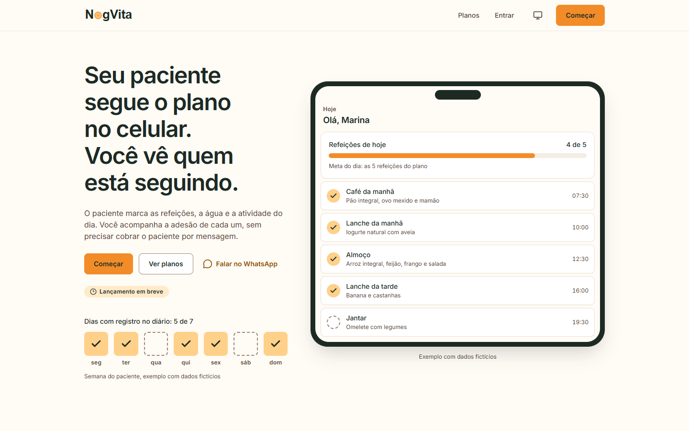
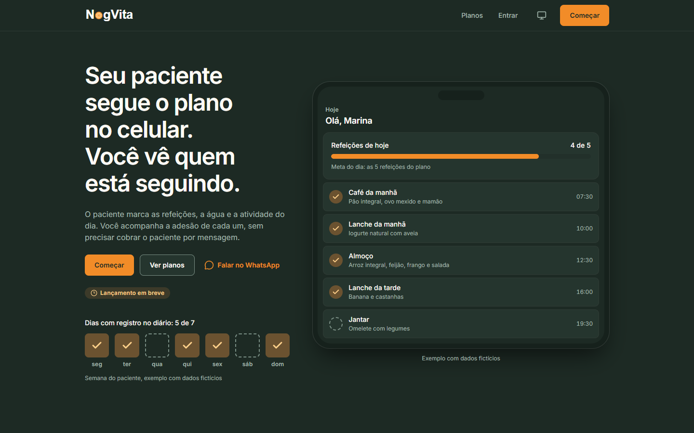
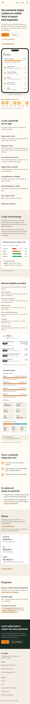
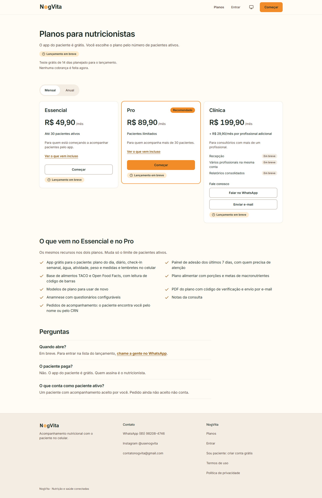

  <picture>
    <source media="(prefers-color-scheme: dark)" srcset="docs/logo-dark.svg">
    
  </picture>

# NogVita

Plataforma de acompanhamento nutricional para nutricionistas e seus pacientes. O nutricionista monta o plano alimentar; o paciente segue o plano no celular, marca refeições, água e atividade; o nutricionista vê a adesão de cada um sem precisar cobrar por mensagem.

**No ar:** [nogvita.com.br](https://nogvita.com.br)

Este repositório é uma vitrine do projeto: telas, arquitetura e as decisões técnicas que guiaram a construção. O código do produto fica em repositórios privados.

  

## O que o produto faz

**Para o paciente (grátis)**
- Plano alimentar do dia com refeições, porções e horários
- Diário alimentar, check-in semanal e devolutiva do nutricionista
- Registro de água, atividade física, peso e medidas
- Lembretes no celular (notificações web push)
- Plano em PDF ou por e-mail

**Para o nutricionista**
- Adesão de cada paciente nos últimos 7 dias, com a lista de quem precisa de atenção
- Plano alimentar com base TACO, Open Food Facts e leitura de código de barras
- Metas de macronutrientes, modelos de plano e PDF com código de verificação
- Anamnese com questionários configuráveis e notas da consulta

## Telas

| Landing (tema claro) | Landing (tema escuro) |
|---|---|
|  |  |

| Celular | Planos |
|---|---|
|  |  |

Todas as telas usam dados fictícios.

## Stack

| Camada | Tecnologia |
|---|---|
| Front-end | Angular 22 (standalone, zoneless, signals, Signal Forms), Tailwind CSS 4, Angular CDK |
| Back-end | .NET 10, ASP.NET Core, Entity Framework Core, FluentValidation |
| Banco | PostgreSQL (Supabase) |
| Hospedagem | Vercel (front), Render (API), Cloudflare Workers (agendamentos) |
| E-mail | Resend, com domínio verificado (SPF, DKIM, DMARC) |
| Testes | Vitest, Playwright com axe-core, xUnit, Testcontainers (Postgres real) |

Arquitetura e fluxos: [docs/arquitetura.md](docs/arquitetura.md). Decisões técnicas: [docs/decisoes.md](docs/decisoes.md).

## Qualidade

- Acessibilidade verificada com axe (WCAG 2.2 AA) em cada tela pública e logada, nos temas claro e escuro.
- Política de segurança de conteúdo (CSP) estrita no front: só scripts do próprio domínio.
- Testes de integração da API rodam contra um PostgreSQL real em container.
- Dados de saúde tratados conforme a LGPD: consentimento versionado, exportação dos próprios dados e exclusão de conta.

## Autor

Luiz Gustavo Nogueira de Lima
