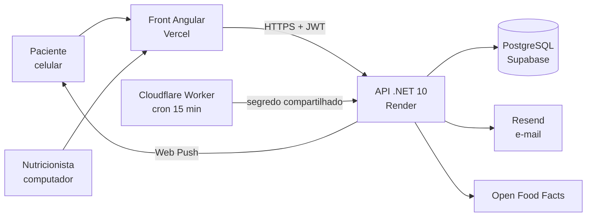
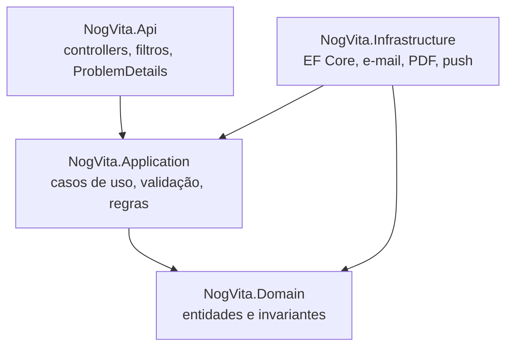
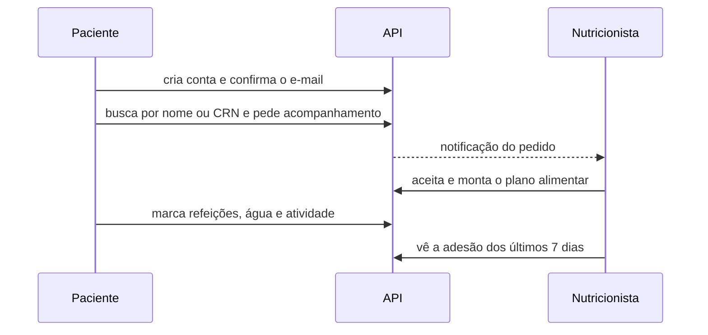

# Arquitetura

## Visão geral

## API em camadas

- **Domain** guarda as regras que não podem ser quebradas: CPF válido, CRN normalizado, estados de acompanhamento.
- **Application** orquestra cada caso de uso e fala com o mundo por interfaces (e-mail, relógio, armazenamento).
- **Infrastructure** implementa essas interfaces: banco, Resend, geração de PDF, notificações web push.
- **Api** expõe os casos de uso e padroniza os erros em ProblemDetails.

## Fluxo de acompanhamento

## Front-end

- Rotas carregadas sob demanda; as páginas públicas não pesam no pacote inicial da área logada.
- Estado com signals e `httpResource`; sessão em `sessionStorage` com renovação de token única por vez.
- Páginas públicas recebem HTML por rota gerado no build (título, descrição, Open Graph e canonical), sem renderização no servidor.
